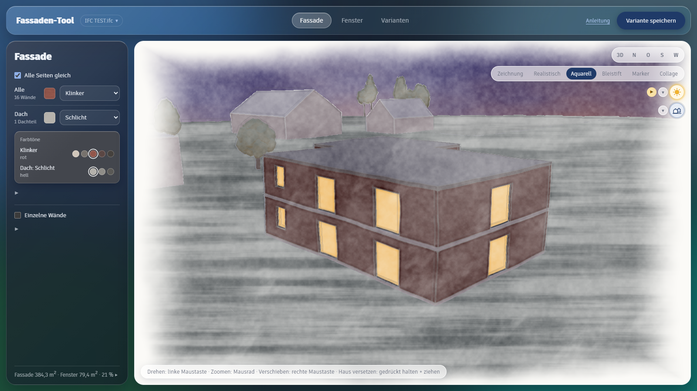
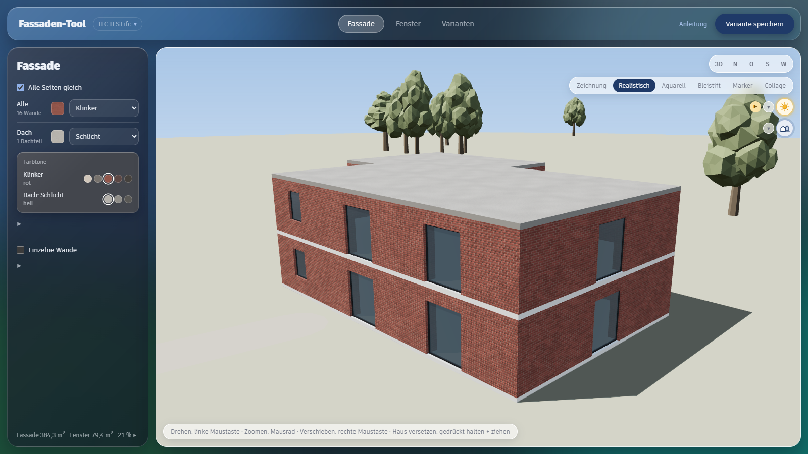
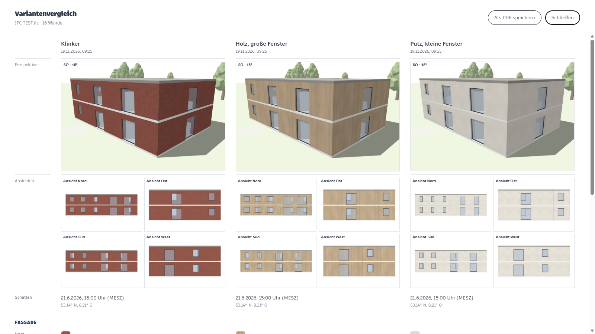
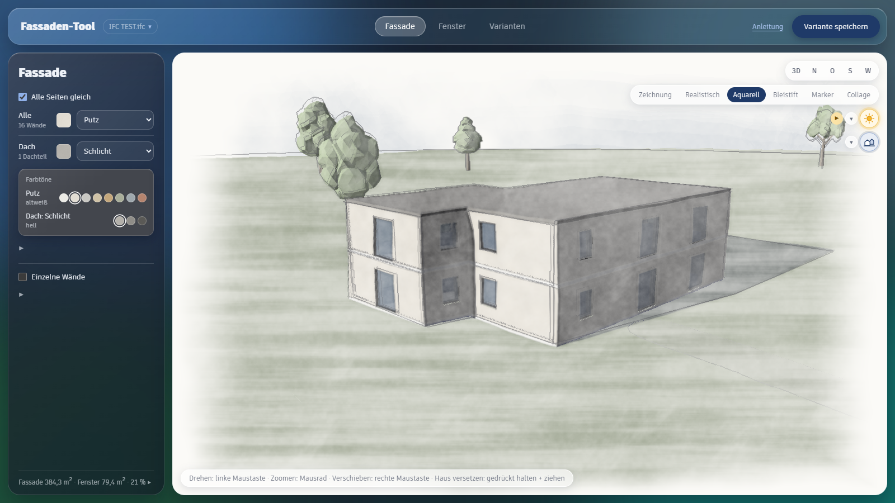
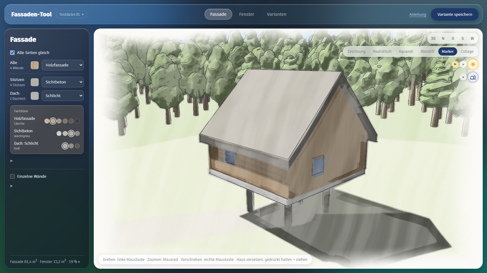
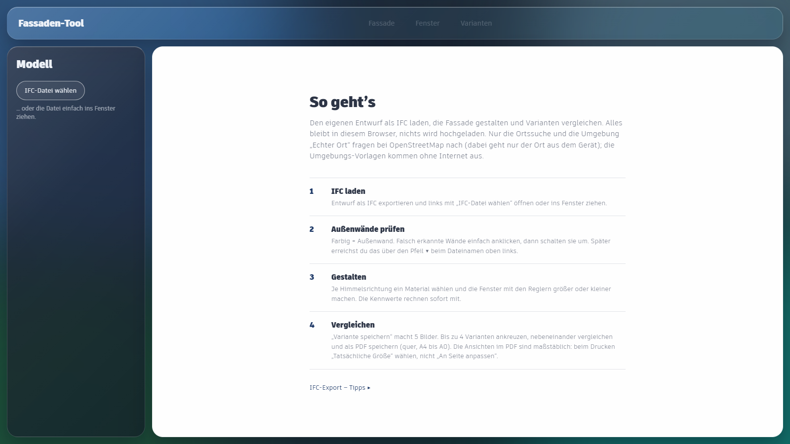

# Fassaden-Tool

**Eigenen Entwurf als IFC hochladen, Fassadenmaterial und Fenstergrößen ausprobieren, Varianten speichern und als maßstäbliches PDF vergleichen – direkt im Browser.**

**Live-Demo:** https://jade-hs-vibecoding-wpk.github.io/fassaden-tool/



Eine kleine Web-App für Architekturstudierende, entstanden in der Vibecoding KI-Werkstatt an der Jade Hochschule (16.–20.11.2026).
Es braucht keine Installation und kein Konto – wer mag, installiert sie als App (siehe unten). Die IFC-Datei bleibt im eigenen Browser und wird nirgends hochgeladen.

## Was das Tool kann

- **IFC laden**: Wände, Fenster, Türen, Dach und Stützen werden in 3D gezeigt. Außenwände erkennt die App selbst, falsch erkannte schaltet man per Klick um.
- **Fassade gestalten**: je Himmelsrichtung oder je Wand ein Material (Klinker, Holz, Putz, Sichtbeton, Platten, Glas, Pfosten-Riegel), mit Farbtönen; Dach und Stützen extra.
- **Fenster ändern**: Breite und Höhe je Seite mit Reglern oder einzelne Fenster in cm. Die Kennwerte (Fassadenfläche, Fensterfläche, Anteil) rechnen sofort mit.
- **Darstellung**: Zeichnung, Realistisch, Aquarell, Bleistift, Marker und Collage.
- **Sonne und Schatten**: für Datum, Uhrzeit und Ort, mit Tagesverlauf als Animation. Im Aquarell gibt es Abendlicht und leuchtende Fenster.
- **Umgebung**: Vorlagen (Städtisch, Ländlich, Wald, Wiese) oder echte Nachbarhäuser aus OpenStreetMap.
- **Varianten**: speichern, nebeneinander vergleichen und als PDF ausgeben (A4–A0 quer, Ansichten maßstäblich 1:50 bis 1:500).

| Realistisch mit Sonne | Variantenvergleich |
|---|---|
|  |  |
| **Aquarell mit Schatten** | **Marker im Wald** |
|  |  |

## So geht's

1. Die [Live-Demo](https://jade-hs-vibecoding-wpk.github.io/fassaden-tool/) öffnen (am besten in Chrome, Edge oder Firefox am Rechner).
2. Den eigenen Entwurf als IFC exportieren (z. B. aus Archicad oder Revit) und mit „IFC-Datei wählen“ öffnen oder ins Fenster ziehen.
3. Außenwände prüfen, Material und Fenster einstellen, „Variante speichern“.
4. Unter „Varianten“ bis zu 4 Varianten ankreuzen, vergleichen und als PDF speichern.
   Beim Drucken „Tatsächliche Größe“ wählen, sonst stimmt der Maßstab nicht.

Tipps für den IFC-Export stehen in der App auf der Startseite unter „IFC-Export – Tipps“.



**Als App installieren** (eigenes Fenster, Symbol im Startmenü, startet auch ohne Internet): die
[Live-Demo](https://jade-hs-vibecoding-wpk.github.io/fassaden-tool/) in **Chrome oder Edge** öffnen und rechts in der
Adresszeile auf das Symbol „App installieren“ klicken (oder Menü ⋮ → „Fassaden-Tool installieren“ bzw. Edge: „Apps“ →
„Diese Website als App installieren“). Einmal mit Internet öffnen, danach geht es auch offline – nur Ortssuche und
Umgebung „Echter Ort“ brauchen weiter Internet. Kein Download einer .exe, keine Sicherheitswarnung.

**Lokal starten** (ohne Internet für die App selbst, Bibliotheken kommen aber per CDN): Ordner herunterladen und darin

```
python -m http.server 8000
```

ausführen, dann http://localhost:8000 öffnen.

## Datenschutz

Die IFC-Datei und die Varianten bleiben im Browser (IndexedDB). Nur zwei Funktionen fragen im Internet nach,
und dabei geht nur der Ort aus dem Gerät: die **Ortssuche** (OpenStreetMap Nominatim) und die Umgebung
**„Echter Ort“** (Overpass-API). Die Umgebungs-Vorlagen kommen ohne Internet aus.

## Technik

Reine statische Webseite (HTML, CSS, JavaScript), läuft auf GitHub Pages. Kein Build-Schritt, keine Installation.
Aufbau und Entscheidungen stehen in [CLAUDE.md](CLAUDE.md), der Ablauf der Sitzungen in [PLAN.md](PLAN.md).

## Quellen und Lizenzen

- [three.js](https://threejs.org/) 0.160.0 – 3D-Darstellung, MIT-Lizenz
- [web-ifc](https://github.com/ThatOpen/engine_web-ifc) 0.0.57 – IFC lesen, MPL-2.0
- [jsPDF](https://github.com/parallax/jsPDF) 2.5.2 – PDF erstellen, MIT-Lizenz
- [Source Sans 3](https://github.com/adobe-fonts/source-sans) – Schrift im PDF, SIL Open Font License 1.1 (liegt in [schriften/](schriften/LICENSE.md))
- [OpenStreetMap](https://www.openstreetmap.org/copyright) über Nominatim (Ortssuche) und Overpass-API (Umgebung) –
  Daten © OpenStreetMap-Mitwirkende, Open Database License (ODbL)
- Alle Fassadentexturen sind im Code selbst gezeichnet, es werden keine Fotos verwendet.

Das Projekt selbst steht unter der [MIT-Lizenz](LICENSE).

## KI-Nutzung

Das Tool wurde mit **KI-Unterstützung** gebaut: Der Code entstand im Gespräch mit
[Claude Code](https://claude.com/claude-code) (Anthropic). Ideen, Gestaltung, Entscheidungen und Tests kamen von der
Studentin, programmiert hat die KI. Der Ablauf ist Sitzung für Sitzung in [PLAN.md](PLAN.md) festgehalten.
